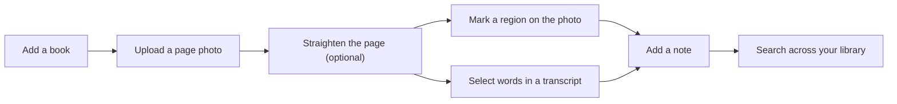

# Bookynotes

**Turn passages in paper books into a searchable library of notes.**

Photograph a page, mark a passage, and add your thoughts. Bookynotes keeps each
note with the text it refers to, its book, and its page, so you can find it again
without remembering where you read it.

[Try Bookynotes](https://bookynotes.vercel.app) ·
[Development & deployment](docs/DEVELOPMENT.md) ·
[Design decisions](docs/DECISIONS.md)

## From page to searchable note



**Two ways to annotate:** draw a rectangle on the photograph and let a vision
model extract the passage and context, or select words in the Reading view to
save the exact quote. Transcripts can be generated or entered manually; manual
transcripts and text selections use no model quota. The source photograph is
retained for comparison.

## What you can do

| Feature | How it works |
| --- | --- |
| **Build a library** | Find books by title or author through Open Library. Covers are stored with the app for faster loading. |
| **Capture pages** | Browse, drag, or paste a photo. Quality checks flag resolution, orientation, framing, exposure, and contrast issues without blocking the upload. |
| **Straighten photos** | Place four corner handles with a zoom preview and keyboard nudging, or use automatic detection. Perspective correction preserves the photo's colour and lighting. |
| **Refine a crop later** | Adjust corners after upload; existing region annotations move with the corrected page. A crop that would cut out a note is refused. The original photo is kept. |
| **Read and annotate** | Switch between the photo and a reflowing, selectable transcript. Anchor notes to an image region or an exact text selection. |
| **Find a passage again** | Search notes, selected or extracted passages, and surrounding context. Results group by book and page and identify what matched. Case and punctuation are handled forgivingly, including phrases such as `he just was`. |
| **Manage your collection** | Dashboards show captured, transcribed, pending, and failed work, with retries for failed extraction. Delete confirmations show how many pages and notes will be removed. |

## How it is built

**Next.js 16 (App Router), React, and strict TypeScript** handle the web app and
server routes. **Supabase** provides Postgres, authentication, and private image
storage, with **Drizzle** for queries and SQL migrations. **sharp** creates
thumbnails; **Python + OpenCV** straighten pages. Vision uses **Gemini** by default
or **OpenRouter**, selected through configuration. The app and Python function
deploy together on **Vercel**.

A few design choices keep the experience reliable:

- **Save first, extract second.** Region notes are saved immediately; model
  extraction runs in a separate request. Completed results are cached, failures
  stay visible and retryable, and rate limits do not consume the retry budget.
  Manual transcripts and text annotations remain usable when quota runs out.
- **Keep anchors stable.** Image regions use normalized coordinates, so marks
  stay aligned across screen sizes and zoom levels. Text annotations store both
  character ranges and quoted text; each note has exactly one anchor type.
- **Upload directly to private storage.** The browser sends photos to Supabase
  through signed URLs. Reads use short-lived signed URLs; the page processor
  exchanges storage keys with the app and reads and writes the bucket directly.
- **Scope access to the reader.** Repositories scope queries by user ID, while
  services check ownership of parent books and pages before writes.

### Performance

Recorded before/after measurements from a production build using a twelve-page
book of 2 MB photographs ([measurement notes](docs/DECISIONS.md)):

| Measure | Before | After |
| --- | --- | --- |
| Library | 1,071 ms | 393 ms |
| Book view | 1,850 ms | 429 ms |
| Page view | 2,550 ms | 799 ms |
| Book grid download | 24.17 MB | 0.19 MB |

The gains came from thumbnails, locally stored covers, connection pooling,
local token verification, and batched, cached signed URLs. Failed image loads
can renew expired URLs, and route loading states give immediate navigation feedback.

## Run locally

Requires **Node 22+**, a Supabase project, and an API key for the configured
vision provider. Follow the [setup guide](docs/DEVELOPMENT.md) to configure the
database and private storage bucket, then:

```bash
npm install
cp .env.example .env.local   # fill in your project's values
npm run db:migrate
npm run dev                 # http://localhost:3000
```

Page straightening is optional: leave both `PAGE_PROCESSOR_URL` and
`PAGE_PROCESSOR_SECRET` unset to keep photos as uploaded. To enable it locally,
follow the [page processor guide](page-processor/README.md); on Windows,
`run.bat` can start both services and create the Python virtualenv on first run.

See the [development guide](docs/DEVELOPMENT.md) for checks, maintenance scripts,
database migrations, deployment configuration, and verification steps.

## Explore the code

| Path | Purpose |
| --- | --- |
| [`src/app/`](src/app/) | Pages and route handlers |
| [`src/features/`](src/features/README.md) | Auth, books, pages, annotations, and search |
| [`src/integrations/`](src/integrations/README.md) | Vision providers, Open Library, storage, and page processing |
| [`src/db/`](src/db/README.md) | Schema, database client, and SQL migrations |
| [`src/components/ui/`](src/components/ui/README.md) | Shared UI primitives |
| [`src/config/`](src/config/README.md) | Validated environment configuration |
| [`api/rectify.py`](api/rectify.py) · [`page-processor/`](page-processor/README.md) | Deployed Python endpoint, OpenCV algorithm, and local server |

Feature READMEs explain individual modules. The append-only
[decision log](docs/DECISIONS.md) records the tradeoffs behind the architecture.
